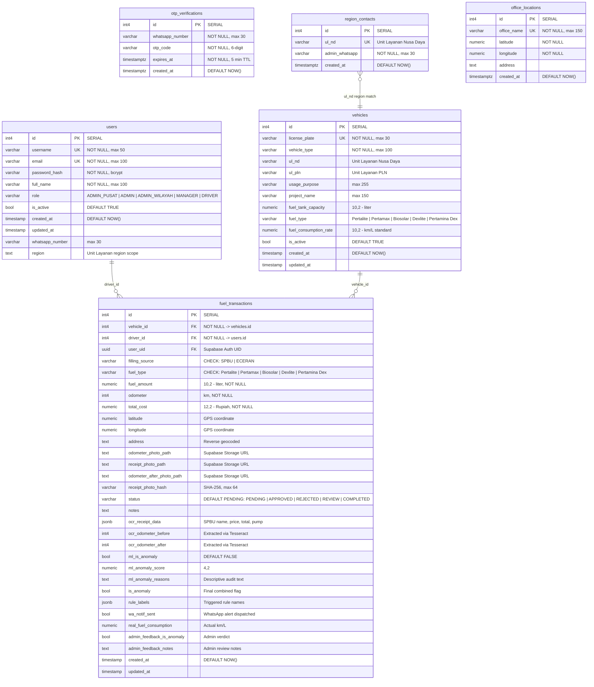

# 📊 Visualisasi Project — Sistem Monitoring BBM UPKAL2
### PLN Nusa Daya UP Kalimantan 2

## 1. Metodologi Waterfall

```mermaid
flowchart TD
    subgraph Phase1["📋 Phase 1: Requirements Analysis"]
        R1["Identifikasi kebutuhan monitoring BBM\nPLN Nusa Daya UP Kalimantan 2"]
        R2["Analisis proses pencatatan BBM manual\n& potensi kecurangan"]
        R3["Req: Input transaksi BBM via mobile Android\n(foto odometer, struk, GPS)"]
        R4["Req: Web dashboard monitoring real-time\ndengan multi-region authority"]
        R5["Req: Deteksi anomali otomatis\n(Rule Engine 9 rules + ML Isolation Forest)"]
        R6["Req: Dual WhatsApp notification\n(Fonnte untuk OTP, Whacenter untuk alert anomali)"]
        R7["Req: OCR untuk struk BBM & odometer\n(Tesseract via ML Engine)"]
        R8["Req: GPS tracking & reverse geocoding\nlokasi pengisian BBM"]
        R9["Req: Multi-role RBAC\n(ADMIN_PUSAT, ADMIN, ADMIN_WILAYAH,\nMANAGER, DRIVER)"]
        R10["Req: Export laporan audit\n(PDF dengan foto bukti, CSV, Excel)"]
        R11["Req: QR Code kendaraan\nuntuk identifikasi armada"]
        R12["Req: Duplicate receipt detection\n(SHA-256 hash)"]
        R1 --> R2 --> R3 --> R4 --> R5 --> R6
        R6 --> R7 --> R8 --> R9 --> R10 --> R11 --> R12
    end

    subgraph Phase2["📐 Phase 2: System Design"]
        D1["Desain arsitektur microservice\n(Mobile + Backend + ML Engine + Dashboard)"]
        D2["Desain database PostgreSQL\n(6 tabel + RLS Policies)\nvia Supabase"]
        D3["Desain REST API\n(Auth, Transactions, Vehicles,\nAnalytics, ML, Drivers, etc.)"]
        D4["Desain hybrid auth 3-tier\n(Local JWT + Supabase JWT + Firebase ID Token)"]
        D5["Desain UI/UX Mobile App\n(Kotlin, Jetpack Compose, Material 3, MVVM)"]
        D6["Desain UI/UX Web Dashboard\n(Next.js 16, React 19, Tailwind v4,\nBase UI, Zustand, React Query)"]
        D7["Desain ML Pipeline\n(Isolation Forest + Rule Engine + OCR)"]
        D8["Desain background job pipeline\n(Redis + BullMQ worker)"]
        D1 --> D2 --> D3 --> D4
        D4 --> D5 --> D6 --> D7 --> D8
    end

    subgraph Phase3["💻 Phase 3: Implementation"]
        I1["Backend: Node.js, Express 5,\npg Pool, Redis, BullMQ"]
        I2["ML Engine: Python, FastAPI,\nscikit-learn, Tesseract OCR"]
        I3["Mobile App: Kotlin, Jetpack Compose,\nCameraX, Retrofit2, Firebase Auth"]
        I4["Web Dashboard: Next.js 16, React 19,\nTailwind v4, Zustand, React Query,\nLeaflet Map, PDFKit"]
        I5["Integrasi API antar 4 komponen"]
        I6["Implementasi BullMQ worker\n(fuel-analysis-queue)"]
        I7["Implementasi dual WhatsApp gateway\n(Fonnte + Whacenter)"]
        I8["Implementasi Supabase\n(Auth, Storage, RLS Policies)"]
        I1 --> I2 --> I3 --> I4
        I4 --> I5 --> I6 --> I7 --> I8
    end

    subgraph Phase4["🧪 Phase 4: Testing"]
        T1["Unit Testing per modul\n(Controllers, Services, Repositories)"]
        T2["Integration Testing API endpoints\n(Auth flow, CRUD, file upload)"]
        T3["Testing ML model accuracy\n(Isolation Forest anomaly detection)"]
        T4["Testing OCR accuracy\n(struk SPBU & dashboard odometer)"]
        T5["Testing Rule Engine\n(9 business rules anomaly detection)"]
        T6["Testing BullMQ worker pipeline\n(queue processing, retry logic)"]
        T7["Testing RBAC & regional isolation\n(5 roles x data scoping)"]
        T8["UAT - User Acceptance Testing"]
        T1 --> T2 --> T3 --> T4
        T4 --> T5 --> T6 --> T7 --> T8
    end

    subgraph Phase5["🚀 Phase 5: Deployment"]
        DEP1["Deploy Backend ke Render\n(Node.js + Express)"]
        DEP2["Deploy ML Engine ke Railway\n(Python + FastAPI + Tesseract)"]
        DEP3["Deploy Web Dashboard ke Vercel\n(Next.js SSR/SSG)"]
        DEP4["Deploy Mobile App via Android Studio\n(APK Direct Install)"]
        DEP5["Setup Supabase\n(PostgreSQL, Auth, Storage, RLS)"]
        DEP6["Setup Upstash Redis\n(BullMQ queue backend)"]
        DEP7["Setup Fonnte & Whacenter\n(WhatsApp API gateways)"]
        DEP8["Konfigurasi environment variables\n& domain CORS"]
        DEP1 --> DEP2 --> DEP3 --> DEP4
        DEP4 --> DEP5 --> DEP6 --> DEP7 --> DEP8
    end

    subgraph Phase6["🔧 Phase 6: Maintenance"]
        M1["Monitoring performa sistem\n& health check endpoints"]
        M2["Retraining ML model\ndengan data terbaru"]
        M3["Bug fixing & patch updates"]
        M4["Backup database PostgreSQL"]
        M5["Update fitur berdasarkan\nfeedback admin & driver"]
        M6["Monitoring BullMQ queue\n& Redis health"]
        M1 --> M2 --> M3 --> M4 --> M5 --> M6
    end

    Phase1 ==> Phase2 ==> Phase3 ==> Phase4 ==> Phase5 ==> Phase6

    style Phase1 fill:#E3F2FD,stroke:#1565C0,stroke-width:2px
    style Phase2 fill:#F3E5F5,stroke:#7B1FA2,stroke-width:2px
    style Phase3 fill:#E8F5E9,stroke:#2E7D32,stroke-width:2px
    style Phase4 fill:#FFF3E0,stroke:#E65100,stroke-width:2px
    style Phase5 fill:#FCE4EC,stroke:#C62828,stroke-width:2px
    style Phase6 fill:#F1F8E9,stroke:#558B2F,stroke-width:2px
```

---

## 2. Use Case Diagram

```mermaid
flowchart LR
    subgraph Actors["👤 Aktor"]
        Driver["🚗 Driver\n(Pengemudi)"]
        AdminPusat["👔 Admin Pusat\n(Central Admin)"]
        AdminWilayah["🏢 Admin Wilayah\n(Regional Admin)"]
        Manager["📋 Manager\n(Pengawas)"]
        System["⚙️ System\n(Automated)"]
    end

    subgraph UC_Auth["🔐 Autentikasi & Otorisasi"]
        UC1["Login via Email/Password\n(Local JWT)"]
        UC2["Login via Firebase\n(Google OAuth)"]
        UC3["Register Akun Baru"]
        UC4["Request OTP via WhatsApp\n(Fonnte)"]
        UC5["Verify OTP"]
        UC6["View Profile"]
        UC7["Logout"]
    end

    subgraph UC_Transaction["⛽ Manajemen Transaksi BBM"]
        UC10["Input Transaksi BBM Baru"]
        UC11["Foto Odometer Before\n(CameraX)"]
        UC12["Foto Struk BBM\n(CameraX)"]
        UC13["Foto Odometer After\n(CameraX)"]
        UC14["Capture GPS Location\n(FusedLocationProvider)"]
        UC15["View Riwayat Transaksi"]
        UC16["View Detail Transaksi"]
        UC17["Edit/Koreksi Data Transaksi"]
        UC18["Approve/Reject Transaksi"]
        UC19["Berikan Feedback Anomali"]
        UC20["Export Laporan PDF\n(dengan foto bukti)"]
        UC21["Export Data CSV/Excel"]
    end

    subgraph UC_Vehicle["🚛 Manajemen Kendaraan"]
        UC25["Tambah Kendaraan"]
        UC26["View Daftar Kendaraan"]
        UC27["Edit Kendaraan"]
        UC28["Hapus Kendaraan\n(Soft Delete)"]
        UC29["Generate QR Code\nStiker Kendaraan"]
        UC30["Scan QR Code\nVerifikasi Plat"]
    end

    subgraph UC_Anomaly["🔍 Deteksi & Analisis Anomali"]
        UC35["OCR Struk BBM\n(Tesseract)"]
        UC36["OCR Odometer\n(Tesseract)"]
        UC37["SHA-256 Duplicate\nReceipt Detection"]
        UC38["Rule-Based Detection\n(9 Business Rules)"]
        UC39["ML Anomaly Detection\n(Isolation Forest)"]
        UC40["BullMQ Background\nAnalysis Worker"]
        UC41["Kirim Alert WhatsApp\n(Whacenter)"]
        UC42["View Antrian Anomali\n(Verification Queue)"]
        UC43["Odometer Audit\n(Distance + Consumption)"]
    end

    subgraph UC_Dashboard["📊 Dashboard & Analytics"]
        UC50["View Dashboard Telemetry\n(KPI, Chart, Map)"]
        UC51["Filter by Region\n(Multi-Region Authority)"]
        UC52["View Tren Konsumsi BBM"]
        UC53["View Statistik Anomali"]
        UC54["View Efisiensi Kendaraan"]
        UC55["View Peta Lokasi\n(Leaflet Kalimantan Map)"]
        UC56["Live PDF Preview\n& Cetak Laporan Audit"]
    end

    subgraph UC_Admin["⚙️ Administrasi Sistem"]
        UC60["Kelola User/Driver"]
        UC61["Kelola Region Contacts\n(WhatsApp Admin Wilayah)"]
        UC62["Kelola Office Locations"]
        UC63["Trigger ML Training"]
        UC64["View ML Model Status"]
        UC65["Batch ML Prediction"]
        UC66["Kirim Email Helpdesk\n(Nodemailer)"]
    end

    %% Driver connections
    Driver --> UC1
    Driver --> UC2
    Driver --> UC3
    Driver --> UC4
    Driver --> UC5
    Driver --> UC6
    Driver --> UC7
    Driver --> UC10
    Driver --> UC15
    Driver --> UC16
    Driver --> UC26
    Driver --> UC30

    %% UC10 includes
    UC10 -.->|include| UC11
    UC10 -.->|include| UC12
    UC10 -.->|include| UC13
    UC10 -.->|include| UC14

    %% Admin Pusat connections
    AdminPusat --> UC1
    AdminPusat --> UC7
    AdminPusat --> UC15
    AdminPusat --> UC16
    AdminPusat --> UC17
    AdminPusat --> UC18
    AdminPusat --> UC19
    AdminPusat --> UC20
    AdminPusat --> UC21
    AdminPusat --> UC25
    AdminPusat --> UC26
    AdminPusat --> UC27
    AdminPusat --> UC28
    AdminPusat --> UC29
    AdminPusat --> UC42
    AdminPusat --> UC50
    AdminPusat --> UC51
    AdminPusat --> UC56
    AdminPusat --> UC60
    AdminPusat --> UC61
    AdminPusat --> UC62
    AdminPusat --> UC63
    AdminPusat --> UC64
    AdminPusat --> UC65

    %% Admin Wilayah connections
    AdminWilayah --> UC1
    AdminWilayah --> UC7
    AdminWilayah --> UC15
    AdminWilayah --> UC16
    AdminWilayah --> UC17
    AdminWilayah --> UC18
    AdminWilayah --> UC19
    AdminWilayah --> UC42
    AdminWilayah --> UC50

    %% Manager connections
    Manager --> UC1
    Manager --> UC7
    Manager --> UC15
    Manager --> UC16
    Manager --> UC18
    Manager --> UC20
    Manager --> UC50
    Manager --> UC52
    Manager --> UC53
    Manager --> UC54

    %% System automated
    System --> UC35
    System --> UC36
    System --> UC37
    System --> UC38
    System --> UC39
    System --> UC40
    System --> UC41
    System --> UC43

    %% Trigger chains
    UC10 -.->|trigger| UC37
    UC37 -.->|if unique| UC40
    UC40 -.->|invoke| UC35
    UC40 -.->|invoke| UC36
    UC40 -.->|invoke| UC38
    UC40 -.->|invoke| UC39
    UC40 -.->|invoke| UC43
    UC39 -.->|if anomaly| UC41
    UC43 -.->|if anomaly| UC41

    style Actors fill:#FFF9C4,stroke:#F57F17,stroke-width:2px
    style UC_Auth fill:#E3F2FD,stroke:#1565C0,stroke-width:1px
    style UC_Transaction fill:#E8F5E9,stroke:#2E7D32,stroke-width:1px
    style UC_Vehicle fill:#F3E5F5,stroke:#7B1FA2,stroke-width:1px
    style UC_Anomaly fill:#FFEBEE,stroke:#C62828,stroke-width:1px
    style UC_Dashboard fill:#FFF3E0,stroke:#E65100,stroke-width:1px
    style UC_Admin fill:#E0F7FA,stroke:#00695C,stroke-width:1px
```

---

## 3. ERD (Entity Relationship Diagram)

---

## 4. System Architecture Workflow

```mermaid
flowchart TD
    subgraph Mobile["📱 Mobile App (Kotlin + Jetpack Compose)"]
        MA1["Login Screen\n(Email/Password or Firebase OAuth)"]
        MA2["Home Dashboard\n(Stats Cards + Recent Tx)"]
        MA3["Create Transaction\n(Multi-step Form)"]
        MA4["📷 CameraX\n(Odometer Before/After + Struk)"]
        MA5["📍 FusedLocationProvider\n(GPS + Reverse Geocode)"]
        MA6["🔍 QR Scanner\n(Vehicle Verification)"]
        MA7["Transaction List & Detail"]
        MA8["Vehicle List"]
        MA9["Profile Screen"]
    end

    subgraph Backend["🖥️ Backend API (Node.js + Express 5)"]
        direction TB
        BE_AUTH["Auth Controller\n• Local JWT (HS256)\n• Supabase JWT (ES256)\n• Firebase ID Token\n• OTP via Fonnte"]
        BE_TX["Transaction Controller\n• CRUD + multipart upload\n• SHA-256 receipt hash check\n• Trigger ML analysis"]
        BE_VEH["Vehicle Controller\n• CRUD + soft delete\n• QR Code HTML generator\n• Plate verification API"]
        BE_ANA["Analytics Controller\n• Summary metrics\n• Consumption trends\n• Anomaly stats"]
        BE_PDF["PDF Service\n(PDFKit)\n• A4 audit report\n• Embedded photos\n• Signatory blocks"]
        BE_MID["Middleware Stack\n• Helmet + CORS\n• Rate Limit (100/15min)\n• Multer (3 files, 5MB)\n• Cookie Parser\n• Winston Logger"]
        BE_RBAC["RBAC Authorization\n5 Roles:\nADMIN_PUSAT | ADMIN\nADMIN_WILAYAH | MANAGER\nDRIVER"]
    end

    subgraph Queue["📬 Background Job Queue"]
        Q1["Redis\n(Upstash)"]
        Q2["BullMQ\nfuel-analysis-queue"]
        Q3["Fuel Analysis Worker\n• Odometer distance audit\n• Consumption rate check\n• Trigger ML Engine\n• Send WhatsApp alert"]
    end

    subgraph MLEngine["🤖 ML Engine (Python + FastAPI)"]
        ML1["Isolation Forest\n(scikit-learn)\nAnomaly Detection"]
        ML2["Rule Engine\n(9 Business Rules)"]
        ML3["OCR Processor\n(Tesseract)\nStruk + Odometer"]
        ML4["Feature Engineering\n• price_per_liter\n• distance_traveled\n• fuel_efficiency\n• hour_of_day\n• day_of_week"]
        ML5["Model Training Pipeline\n(/train endpoint)"]
        ML7["/analyze-transaction\nFull Pipeline Endpoint"]
        ML8["/validate/:id\nDirect Validation"]
    end

    subgraph Database["🗄️ Supabase Platform"]
        DB1[("PostgreSQL\n6 Tables\n+ RLS Policies")]
        DB2["Supabase Auth\n(JWT Provider)"]
        DB3["Supabase Storage\n(uploads bucket)\ntransactions/PLATE/YYYY-MM/"]
    end

    subgraph Dashboard["🌐 Web Dashboard (Next.js 16 + React 19)"]
        WD1["Login Portal\n(PLN Nusa Daya branding)"]
        WD2["Dashboard Telemetry\n• KPI Cards\n• Consumption Chart\n• Donut Allocation\n• Kalimantan Leaflet Map\n• Anomaly Queue"]
        WD3["Transaction Audit Console\n• Dual-pane layout\n• Photo evidence inspector\n• Quick approve/reject"]
        WD4["Transaction Review\n• Zoom/pan photo viewer\n• ML feedback loop\n• Data correction form\n• WhatsApp driver contact"]
        WD5["Reports Center\n• Region filter\n• Live PDF preview\n• Download PDF"]
        WD6["Vehicle Management\n• Fleet cards\n• Registration modal\n• QR sticker printing"]
        WD7["Admin Pages\n• Drivers, Region Contacts\n• Office Locations\n• ML Management"]
    end

    subgraph WhatsApp["📱 WhatsApp Gateways"]
        WA1["Fonnte API\n(api.fonnte.com)\n→ OTP Verification"]
        WA2["Whacenter API\n(app.whacenter.com)\n→ Anomaly Alerts\n→ Feedback Notifications"]
    end

    %% Mobile flows
    MA1 -->|"POST /api/auth/login\nor /api/auth/firebase-sync"| BE_AUTH
    MA3 -->|"POST /api/fuel-transactions\n(multipart: 3 photos + JSON)"| BE_TX
    MA4 -->|"compressed JPEG"| MA3
    MA5 -->|"lat, lng, address"| MA3
    MA6 -->|"GET /api/vehicles/verify/:plate"| BE_VEH
    MA7 -->|"GET /api/fuel-transactions/history"| BE_TX
    MA2 -->|"GET /api/fuel-transactions/summary"| BE_ANA

    %% Dashboard flows
    WD1 -->|"POST /api/auth/login\n(sets HttpOnly cookie)"| BE_AUTH
    WD2 -->|"GET /api/fuel-transactions/summary\n+ /analytics"| BE_ANA
    WD3 -->|"GET /history + PATCH /status"| BE_TX
    WD4 -->|"PUT /:id + POST /:id/feedback"| BE_TX
    WD5 -->|"GET /export-pdf"| BE_PDF
    WD6 -->|"CRUD /api/vehicles\n+ GET /qrcode/:plate"| BE_VEH

    %% Backend internal
    BE_AUTH -->|"verify token"| DB2
    BE_AUTH -->|"send OTP"| WA1
    BE_TX -->|"upload photos"| DB3
    BE_TX -->|"CRUD queries"| DB1
    BE_TX -->|"SHA-256 hash check\n(duplicate receipt)"| DB1
    BE_ANA -->|"aggregate SQL"| DB1
    BE_PDF -->|"query + generate"| DB1

    %% Backend → Queue → ML
    BE_TX -->|"1. GET /validate/:id\n(fire-and-forget)"| ML8
    BE_TX -->|"2. enqueue job"| Q2
    Q2 --- Q1
    Q2 --> Q3
    Q3 -->|"POST /detect"| ML1
    Q3 -->|"odometer audit\n(distance, km/L)"| DB1
    Q3 -->|"if anomaly → alert"| WA2

    %% ML Engine internal
    ML8 --> ML3
    ML8 --> ML2
    ML8 --> ML1
    ML7 --> ML3
    ML7 --> ML2
    ML7 --> ML1
    ML3 -->|"OCR results"| ML4
    ML4 -->|"features"| ML1
    ML5 -->|"fetch training data"| DB1
    ML7 -->|"update tx flags"| DB1
    ML8 -->|"update tx flags"| DB1

    %% WhatsApp delivery
    WA1 -->|"OTP message"| DriverPhone["🚗 Driver Phone"]
    WA2 -->|"Anomaly alert"| AdminPhone["👔 Admin Phone"]

    style Mobile fill:#E8F5E9,stroke:#2E7D32,stroke-width:2px
    style Backend fill:#E3F2FD,stroke:#1565C0,stroke-width:2px
    style Queue fill:#FFF9C4,stroke:#F57F17,stroke-width:2px
    style MLEngine fill:#FFF3E0,stroke:#E65100,stroke-width:2px
    style Database fill:#FCE4EC,stroke:#C62828,stroke-width:2px
    style Dashboard fill:#F3E5F5,stroke:#7B1FA2,stroke-width:2px
    style WhatsApp fill:#C8E6C9,stroke:#2E7D32,stroke-width:2px
```

---

## 5. Infrastruktur Server

```mermaid
flowchart TD
    subgraph Users["👥 End Users"]
        U1["🚗 Driver\n(Android Phone)"]
        U2["👔 Admin Pusat\n(Web Browser)"]
        U3["🏢 Admin Wilayah\n(Web Browser + WhatsApp)"]
        U4["📋 Manager\n(Web Browser)"]
    end

    subgraph Vercel["🔺 Vercel (Frontend Hosting)"]
        V1["Vercel Edge Network\n(Global CDN + SSL)"]
        V2["Next.js 16 Serverless\nSSR + API Routes"]
        V3["Nodemailer\n(IT Helpdesk Email)"]
        V_URL["fuel-monitoring-bbm-frontend-gamma.vercel.app"]
    end

    subgraph Render["☁️ Render (Backend Hosting)"]
        R1["Render Web Service\n(Auto-deploy from GitHub)"]
        R2["Node.js Express 5 Server"]
        R3["BullMQ Worker Process\n(fuel-analysis-queue)"]
        R4["Multer File Handler\n(Memory Storage, 5MB limit)"]
        R5["PDFKit Report Generator"]
        R_ENV["Environment:\nJWT_SECRET, SUPABASE_URL,\nML_ENGINE_URL, WHACENTER_*,\nWA_API_KEY, REDIS_URL"]
    end

    subgraph Railway["🚂 Railway (ML Engine Hosting)"]
        RW1["Railway Container\n(Procfile: uvicorn)"]
        RW2["Python FastAPI Server"]
        RW3["scikit-learn + XGBoost\n+ LightGBM Runtime"]
        RW4["Tesseract OCR Runtime\n(pytesseract)"]
        RW5["Model Files Storage\n(/models/*.joblib)"]
    end

    subgraph Supabase["🟢 Supabase Platform"]
        SB1[("PostgreSQL Database\n6 Tables + RLS Policies\n+ PostgREST")]
        SB2["Supabase Auth\n(JWT: HS256 + ES256)\nEmail/Password Provider"]
        SB3["Supabase Storage\n(uploads bucket)\ntransactions/PLATE/YYYY-MM/"]
    end

    subgraph Redis["🔴 Upstash Redis"]
        RED1["Redis Cloud\n(TLS Encrypted)"]
        RED2["BullMQ Queue Backend\nfuel-analysis-queue"]
    end

    subgraph Firebase["🔥 Firebase"]
        FB1["Firebase Auth\n(Google OAuth)\nMobile SDK"]
        FB2["Firebase Admin SDK\n(ID Token Verification)"]
    end

    subgraph WhatsApp["📱 WhatsApp Gateways"]
        WA1["Fonnte API\n(api.fonnte.com)\nOTP Delivery"]
        WA2["Whacenter API\n(app.whacenter.com)\nAnomaly Alerts +\nFeedback Notifications"]
    end

    subgraph Android["📱 Android Distribution"]
        AN1["Android Studio\nBuild System"]
        AN2["APK / AAB\nDirect Install\nMin SDK 26"]
    end

    %% User → Frontend
    U2 -->|"HTTPS"| V1
    U3 -->|"HTTPS"| V1
    U4 -->|"HTTPS"| V1

    %% User → Mobile
    U1 -->|"Install APK"| AN2

    %% Vercel internals
    V1 --> V2
    V2 --> V3
    V2 --> V_URL

    %% Frontend → Backend
    V2 -->|"REST API\n(Axios + Bearer JWT)"| R2

    %% Mobile → Backend
    AN2 -->|"REST API\n(Retrofit2 + Bearer JWT)"| R2

    %% Mobile → Firebase
    AN2 -->|"Google OAuth"| FB1

    %% Render internals
    R1 --> R2
    R2 --> R3
    R2 --> R4
    R2 --> R5
    R2 --> R_ENV

    %% Backend → Database
    R2 -->|"pg Pool\n(SQL + SSL)"| SB1
    R2 -->|"Verify JWT"| SB2
    R4 -->|"Upload photos"| SB3
    R2 -->|"Firebase verify"| FB2

    %% Backend → Redis/Queue
    R2 -->|"Enqueue jobs"| RED2
    R3 -->|"Process jobs"| RED2
    RED2 --- RED1

    %% Backend → ML Engine
    R2 -->|"GET /validate/:id\n(fire-and-forget)"| RW2
    R3 -->|"POST /detect\n(from worker)"| RW2

    %% ML Engine internals
    RW1 --> RW2
    RW2 --> RW3
    RW2 --> RW4
    RW2 --> RW5

    %% ML Engine → Database
    RW2 -->|"Supabase Python Client"| SB1
    RW2 -->|"Download photos"| SB3

    %% WhatsApp connections
    R2 -->|"OTP request"| WA1
    R3 -->|"Anomaly alert"| WA2
    RW2 -->|"Anomaly alert\n(fallback)"| WA1
    WA1 -->|"OTP code"| U1
    WA2 -->|"Alert notification"| U3

    %% Supabase internals
    SB1 --- SB2
    SB1 --- SB3

    %% Android build
    AN1 --> AN2

    style Users fill:#FFF9C4,stroke:#F57F17,stroke-width:2px
    style Vercel fill:#F3E5F5,stroke:#7B1FA2,stroke-width:2px
    style Render fill:#E3F2FD,stroke:#1565C0,stroke-width:2px
    style Railway fill:#E8F5E9,stroke:#2E7D32,stroke-width:2px
    style Supabase fill:#FCE4EC,stroke:#C62828,stroke-width:2px
    style Redis fill:#FFEBEE,stroke:#D32F2F,stroke-width:2px
    style Firebase fill:#FFF3E0,stroke:#E65100,stroke-width:2px
    style WhatsApp fill:#C8E6C9,stroke:#2E7D32,stroke-width:2px
    style Android fill:#FFF9C4,stroke:#F57F17,stroke-width:2px
```

## 📌 Ringkasan Teknologi (Updated)

| Komponen | Teknologi | Deployment |
|----------|-----------|------------|
| **Mobile App** | Kotlin, Jetpack Compose, CameraX, Retrofit2, Firebase Auth, osmdroid | Android Studio (APK) |
| **Web Dashboard** | Next.js 16, React 19, Tailwind v4, Base UI, Zustand, React Query, Leaflet | Vercel |
| **Backend API** | Node.js, Express 5, pg Pool, BullMQ, Multer, PDFKit, Winston, Joi | Render |
| **ML Engine** | Python, FastAPI, scikit-learn, XGBoost, Tesseract OCR | Railway |
| **Database** | PostgreSQL + RLS Policies | Supabase |
| **Auth** | Hybrid 3-tier: Local JWT (HS256) + Supabase JWT (ES256) + Firebase ID Token | Supabase + Firebase |
| **File Storage** | Supabase Storage (uploads bucket) | Supabase |
| **Job Queue** | Redis + BullMQ (fuel-analysis-queue) | Upstash Redis |
| **WhatsApp OTP** | Fonnte API | External |
| **WhatsApp Alerts** | Whacenter API | External |
| **Email Helpdesk** | Nodemailer | Vercel Serverless |

### Roles & Access Matrix

| Role | Scope | Key Capabilities |
|------|-------|------------------|
| `ADMIN_PUSAT` | All regions | Full CRUD, ML management, all analytics, user management |
| `ADMIN` | All regions | Vehicle/transaction CRUD, analytics, driver management |
| `ADMIN_WILAYAH` | Own region only | Review transactions, approve/reject, feedback (region-scoped) |
| `MANAGER` | Own region | View transactions, analytics, approve/reject, PDF reports |
| `DRIVER` | Own data only | Create transactions, view own history, vehicle list |
